# 🧑‍💻 Portfólio — Duda Brito

> Portfólio profissional bilíngue (PT/EN) de Maria Eduarda "Duda" Brito, estudante de Engenharia de Software na PUC Minas, feito com **React + Vite**.

Trabalho da disciplina de Desenvolvimento e Integração de Aplicações Web. A identidade visual e os textos do portfólio HTML original foram preservados; esta versão os reorganiza em componentes React.

---

## 🚧 Status do Projeto

  

| Item | Situação |
| --- | --- |
| Código, lint, build de produção e testes automatizados | ✅ Funcionando (53 testes, executados em jsdom) |
| Repositório GitHub | ⏳ Pendente — a pasta ainda não é um repositório Git ([procedimento](docs/DEPLOY.md)) |
| Publicação (deploy) | ⏳ Pendente — plataforma recomendada: Netlify ([análise e passos](docs/DEPLOY.md)) |
| Envio real de e-mail (EmailJS) | ⏳ Pendente — conta e template ainda não criados; só vale como funcional após o recebimento de um e-mail de teste |
| Protótipos no Figma | ⏳ Pendente — não criados; guia em [docs/PROTOTIPOS.md](docs/PROTOTIPOS.md) |

---

## 📚 Índice

[Links úteis](#-links-úteis) · [Sobre o projeto](#-sobre-o-projeto) · [Funcionalidades](#-funcionalidades-principais) · [Tecnologias](#-tecnologias-utilizadas) · [Arquitetura](#-arquitetura) · [Instalação e execução](#-instalação-e-execução) · [Deploy](#-deploy) · [Estrutura de pastas](#-estrutura-de-pastas) · [Demonstração](#-demonstração) · [Testes](#-testes) · [Pendências](#-pendências) · [Documentações](#-documentações-utilizadas) · [Autoria](#-autoria) · [Contribuição](#-contribuição) · [Licença](#-licença)

---

## 🔗 Links úteis

* 🌐 **Site publicado:** `ADICIONAR_URL_DO_DEPLOY` _(pendente — ainda não publicado; ver [docs/DEPLOY.md](docs/DEPLOY.md))_
* 🗂️ **Repositório:** `ADICIONAR_URL_DO_GITHUB` _(pendente — ainda não criado)_
* 🎨 **Protótipos no Figma:** `ADICIONAR_LINK_DO_FIGMA` _(pendente — ainda não criados; ver [docs/PROTOTIPOS.md](docs/PROTOTIPOS.md))_
* 🕰️ **Portfólio anterior (HTML puro):** <https://mariabdev.netlify.app/>
* 📖 **Documentação do projeto:** [docs/DEPLOY.md](docs/DEPLOY.md) · [docs/PROTOTIPOS.md](docs/PROTOTIPOS.md) · especificações em [docs/sdd/](docs/sdd/)
* 📖 **Template de README seguido:** [template_README.md do Prof. João Paulo Aramuni](https://github.com/joaopauloaramuni/desenvolvimento-e-integracao-de-aplicacoes-web/blob/main/TEMPLATES/template_README.md) (organização própria preservada)

---

## 📝 Sobre o projeto

Site pessoal para apresentar trajetória acadêmica e profissional, habilidades, projetos, experiências e formas de contato. Existia antes como um site HTML/CSS/JS; foi migrado para React + Vite mantendo textos, tema visual e interações.

Páginas:

| Rota | Conteúdo |
| --- | --- |
| `/` | Terminal interativo (início), Sobre mim, Habilidades, Projetos (timeline), Experiências, Contato e rodapé |
| `/curriculo` (ou `/resume`) | Currículo em uma página, com índice numerado e botão de imprimir/salvar em PDF |
| `/academico` (ou `/academics`) | Trajetória acadêmica: linha do tempo do curso, formação, atividades por ano e (quando preenchidas) disciplinas e notas |
| `/servicos` | Serviços web oferecidos, cases (BECAS, Ágape Vestir), FAQ e contato |
| `/estudos-de-caso/whatsapp-dispatcher` | Estudo de caso de arquitetura (PT/EN) |

---

## ✨ Funcionalidades principais

- 💻 **Terminal interativo na abertura** (`src/terminal/`): o visitante digita comandos como `ajuda`, `sobre`, `ls`, `cd projetos`, `projetos`, `experiencias`, `curriculo`, `academico`, `contato`, `tema` e `idioma` (nomes em PT ou EN). Tem autocompletar com Tab, histórico com ↑/↓, `Ctrl+L` para limpar, saída redesenhada ao trocar de idioma e histórico mantido durante a visita. Atalhos clicáveis abaixo do terminal deixam tudo acessível no celular.
- 📄 **Currículo web** (`/curriculo`): versão em página do currículo, com seções numeradas, índice fixo, competências com tempo de uso (contado a partir do primeiro projeto ou curso com cada tecnologia, em `src/data/skillTimeline.js`), experiências em cards numerados com "Mostrar mais", formação e reconhecimentos com contagem (2× finalista) e impressão limpa (o botão abre a janela de impressão; "Salvar como PDF" gera o arquivo).
- 🎓 **Página Acadêmico** (`/academico`): linha do tempo de 2025 até a previsão de conclusão (2029) com a posição de hoje, formação, números de destaque e atividades por ano. A seção **Disciplinas e notas** por semestre (carga horária, modalidade, nota e média) já vem com 4 semestres como placeholder (01/2025, 02/2025 e 01/2026 em Ciência da Computação; 02/2026 em Engenharia de Software, em andamento). Para preencher, adicione as disciplinas em `courses` dentro de `src/data/academics.js` (formato documentado no próprio arquivo); carga horária e média aparecem sozinhas.
- 🌍 **Português e inglês** com troca no cabeçalho, preferência salva em `localStorage` e permanência na página/seção atual.
- 🌗 **Tema claro/escuro**, salvo em `localStorage` e aplicado antes do primeiro desenho (sem "flash").
- 🕰️ **Timeline de projetos dinâmica**, gerada de `src/data/projects.jsx` e ordenada do mais antigo ao mais recente por data `{ ano, mês? }`. A data aparece como `MM/AAAA` ou só `AAAA`; quando o mês não é conhecido e há outro projeto no mesmo ano, a interface indica que a ordem entre eles é indeterminada.
- 🧠 **Apresentações originais preservadas:** WhatsApp Dispatcher como estudo de caso, evolução v1 → v2 do EcoShop, contexto de produto do Planoriza e projetos menores.
- 🧑‍🎓 **Experiências unificadas** (acadêmicas/extensão, cursos e competições, reconhecimentos) — sem seção duplicada.
- ✉️ **Formulário de contato** (nome, e-mail, mensagem) com validação, mensagens de erro acessíveis e traduzidas, estado de carregamento, bloqueio de envio duplicado, proteções básicas contra bots e integração com **EmailJS** (envio real ainda não comprovado; ver [Configurar o envio](#️-configurar-o-envio-de-e-mail-emailjs)).
- ✨ **Animações de entrada** com um único `IntersectionObserver`, desligadas com `prefers-reduced-motion`.
- 🖱️ **Efeito radial** que acompanha o cursor nos cards.
- ❓ **FAQ** em acordeão (ARIA + setas do teclado) e 🖼️ **lightbox** (Esc, setas, contador, bloqueio de rolagem, retorno do foco).
- 📱 **Responsivo**, com menu recolhível em telas pequenas.

---

## 🛠 Tecnologias utilizadas

**Front-end** (não há back-end nem banco de dados):

| Camada | Tecnologia (versão em `package.json`) |
| --- | --- |
| Biblioteca de UI | React ^19.1 e React DOM ^19.1 |
| Build / dev server | Vite ^6.3 + `@vitejs/plugin-react` ^4.7 |
| Linguagem | JavaScript (JSX), módulos ES |
| Estilo | CSS puro (folha original preservada + complementos) |
| Roteamento | Implementação mínima própria sobre a History API (`src/router.jsx`) |
| Estado | `useState` + Context API (idioma) — sem biblioteca de estado |
| E-mail | `@emailjs/browser` ^4.4 (versão instalada: 4.4.1) |

**Qualidade (desenvolvimento):** Vitest ^5, Testing Library (react ^16, jest-dom, user-event), jsdom ^29, ESLint ^9 (com plugins react e react-hooks), Prettier ^3.

**Infraestrutura:** SPA estática gerada em `dist/`. Hospedagem recomendada: Netlify (configuração em `netlify.toml` e `public/_redirects`; `vercel.json` mantido como alternativa). Ainda **não publicada**. Sem contêineres nem CI/CD configurados.

**Dependências de execução:** `react`, `react-dom`, `@emailjs/browser`. Todo o resto é de desenvolvimento.

---

## 🏗 Arquitetura

SPA estática, sem back-end. Textos e dados ficam em `src/data`, separados dos componentes; páginas montam seções; seções usam componentes reutilizáveis.

```text
main.jsx → RouterProvider → LanguageProvider → App (escolhe a página pela rota)
                                                ├─ Home      → sections/portfolio/*
                                                ├─ Services  → Faq, ImageGallery, ContactLinks
                                                ├─ CaseStudy → pages/case-study/* (JSX do original)
                                                └─ NotFound
```

Decisões:

- **Roteamento próprio** (`src/router.jsx`): são só três rotas e uma 404; evita uma dependência. Usa a History API e trata links com âncora (`/#projetos`), botão voltar e recarga. Em produção exige o fallback `/* → /index.html` da hospedagem.
- **Internacionalização sem biblioteca:** `LanguageContext` guarda o idioma (PT/EN) em `localStorage` e em `<html lang>`. Textos de interface ficam em `src/i18n/ui.js`; conteúdo em `src/data/*` com chaves `pt` e `en`. A troca mantém rota e seção.
- **Tema claro/escuro:** atributo `data-theme` no `<html>`, aplicado por script inline em `index.html` antes do React, para evitar flash.
- **Organização:** `pages/` (uma por rota) → `sections/portfolio/` (blocos da home) → `components/` (reutilizáveis: Header, Faq, Lightbox, ImageGallery, ContactForm). Dados e regras ficam fora do JSX: `utils/projectDate.js` (datas e ordenação), `utils/validateContact.js` (validação).
- **Timeline orientada a dados:** datas com precisão variável `{ year, month? }`; nenhum mês é presumido.
- **Sem `dangerouslySetInnerHTML`:** o HTML original virou JSX e os `addEventListener` do script original viraram componentes (`Reveal`, `Faq`, `Lightbox`, `handleRadialGlow`) com limpeza no desmontar.
- **EmailJS isolado** em `src/services/emailService.js`; o formulário só conhece `sendContactMessage` e `classifySendError`. Chamada única por envio, sem resposta automática e sem armazenamento. Trade-off: as chaves do EmailJS ficam no JavaScript do navegador (são públicas por desenho), então a proteção real está nas restrições da conta (domínio e limite de envios).
- O HTML/CSS/JS originais continuam em `docs/site-original/` para consulta.

---

## ⚙️ Instalação e execução

**Pré-requisitos:** Node.js 20.19+ (`.nvmrc` indica 22) e npm. Git, para clonar.

```bash
git clone ADICIONAR_URL_DO_GITHUB   # pendente: o repositório ainda não existe
cd portfolio-react-vite
npm install
cp .env.example .env     # Windows PowerShell: Copy-Item .env.example .env
npm run dev              # http://localhost:5173
```

Outros comandos:

```bash
npm run build     # build de produção em dist/ (variáveis VITE_* são lidas aqui)
npm run preview   # serve o build em http://localhost:4173
npm run lint      # ESLint
npm test          # testes (Vitest)
```

### 🔑 Variáveis de ambiente

| Variável | Para que serve |
| --- | --- |
| `VITE_EMAILJS_SERVICE_ID` | ID do serviço de e-mail no EmailJS |
| `VITE_EMAILJS_TEMPLATE_ID` | ID do template no EmailJS |
| `VITE_EMAILJS_PUBLIC_KEY` | Public Key (Account → General) |

Sem elas o site funciona normalmente; o formulário valida, mas ao enviar informa que o envio não está ativo e mostra o e-mail para contato direto. Nada é "enviado" de mentira.

### ✉️ Configurar o envio de e-mail (EmailJS)

O formulário envia nome, e-mail e mensagem para `mariaeduardadepaulabrito@gmail.com`. Nada é armazenado pelo site e **nenhuma resposta automática** é enviada ao visitante.

#### Valores de ambiente

| Variável (Vite) | De onde vem | Natureza |
| --- | --- | --- |
| `VITE_EMAILJS_SERVICE_ID` | *Email Services* → ID do serviço (`service_xxxxxxx`) | Público (vai no JS) |
| `VITE_EMAILJS_TEMPLATE_ID` | *Email Templates* → ID do template (`template_xxxxxxx`) | Público (vai no JS) |
| `VITE_EMAILJS_PUBLIC_KEY` | *Account → General* → **Public Key** | Público (vai no JS) |

**Nunca** coloque no código, no `.env` versionado ou na hospedagem: a senha do Gmail, senhas de app ou a **Private Key / Access Token** do EmailJS. O `.env` já está no `.gitignore`. Como as variáveis `VITE_*` são embutidas **no momento do build**, qualquer mudança exige novo build/deploy.

#### Passo a passo

1. **Conta:** acesse <https://www.emailjs.com/>, clique em *Sign Up Free* e confirme o e-mail.
2. **Serviço:** em *Email Services* → *Add New Service* → *Gmail* → *Connect Account*, autorize `mariaeduardadepaulabrito@gmail.com` e salve. Copie o **Service ID**.
3. **Template:** em *Email Templates* → *Create New Template* e configure:
   - *To Email*: `mariaeduardadepaulabrito@gmail.com`
   - *Reply To*: `{{reply_to}}` (assim "Responder" no Gmail vai para o visitante)
   - *From Name*: `{{from_name}}`
   - *Subject*: `Contato pelo portfólio — {{from_name}}`
   - *Content*: use exatamente estas variáveis:

     ```text
     Nome: {{from_name}}
     E-mail: {{from_email}}

     {{message}}
     ```

   - Salve e copie o **Template ID**. A aplicação envia exatamente `from_name`, `from_email`, `reply_to` e `message`.
4. **Sem resposta automática:** abra a aba **Auto-Reply** do template e mantenha-a **desativada**.
5. **Public Key:** em *Account → General*, copie a **Public Key**.
6. **Local:** copie `.env.example` para `.env`, preencha as três variáveis e reinicie `npm run dev`.
7. **Segurança na conta:** em *Account → Security*, restrinja os *Allowed Domains* ao domínio publicado (e `localhost` durante o teste) e ative o limite de envios. O site também usa o bloqueio de navegadores *headless* e um intervalo de 15 s entre envios do SDK, além de um campo-armadilha invisível contra bots.
8. **Hospedagem:** cadastre as mesmas três variáveis no painel (Netlify: *Site configuration → Environment variables*; Vercel: *Settings → Environment Variables*) **antes** de publicar e faça um novo deploy.

#### Teste real (ação sua)

1. Com o `.env` preenchido, rode `npm run dev`, abra a seção Contato e envie uma mensagem com um e-mail seu diferente do destino.
2. Confirme que a mensagem chegou na caixa de entrada (ou no spam) de `mariaeduardadepaulabrito@gmail.com`, com nome, e-mail e texto corretos, e que o botão *Responder* endereça o e-mail digitado.
3. Confirme que o e-mail de teste **não** recebeu resposta automática.
4. Repita no site publicado e guarde a captura do e-mail recebido como evidência.

Se algo falhar: erro 400 costuma ser ID errado ou variável do template diferente; 412/403 indica serviço Gmail desconectado ou domínio não permitido. Os detalhes saem no console do navegador.

> **Estado atual:** o envio real **não foi testado**. A conta EmailJS ainda não existe, então a integração só deve ser considerada funcional após a confirmação do recebimento acima. Os testes automatizados usam o SDK simulado: cobrem validação, estados da interface, parâmetros enviados, falhas e ausência de configuração, mas **não provam** o envio.

---

## 🚀 Deploy

O projeto gera arquivos estáticos em `dist/` (`npm run build`). Como o site tem rotas (`/servicos`), a hospedagem precisa devolver `index.html` para qualquer caminho: já configurado em `netlify.toml` e `public/_redirects` (Netlify) e em `vercel.json` (Vercel).

**Plataforma recomendada: Netlify.** Plano gratuito, atende à SPA sem ajustes e você já tem um site ali (`mariabdev.netlify.app`), que pode ser religado ao novo repositório mantendo a URL, ou substituído por um site novo para não sobrescrever a versão antiga. A comparação com Vercel e Render e os riscos de reaproveitar o site estão em [docs/DEPLOY.md](docs/DEPLOY.md).

Resumo: criar o repositório no GitHub → importar no Netlify (build `npm run build`, publicação `dist`) → cadastrar `VITE_EMAILJS_*` **antes** do deploy → publicar → validar com o checklist de [docs/DEPLOY.md](docs/DEPLOY.md#5-checklist-de-validação-da-publicação). **Nada disso foi executado ainda.**

---

## 📂 Estrutura de pastas

```text
├── index.html                 # tema/idioma salvos aplicados antes do React
├── public/
│   ├── assets/                # foto, imagem de compartilhamento (og-image)
│   ├── cases/                 # capturas: EcoShop, BECAS, Ágape
│   └── _redirects             # fallback SPA (Netlify)
├── src/
│   ├── main.jsx · App.jsx · router.jsx
│   ├── pages/                 # Home, Resume, Academics, Services, CaseStudy, NotFound
│   ├── terminal/              # Terminal.jsx (interface) + commands.jsx (interpretador)
│   │   └── case-study/        # estudo de caso original em JSX (PT e EN)
│   ├── sections/portfolio/    # About, Skills, Projects, Experience, Contact
│   ├── components/            # Header, Footer, Reveal, Faq, Lightbox, ImageGallery, ContactForm…
│   ├── data/                  # profile, portfolio, projects, experiences, services, resume, academics
│   ├── i18n/                  # LanguageContext + textos de interface
│   ├── hooks/ · utils/ · services/
│   ├── styles/                # original.css (preservado), portfolio.css, case-study.css, terminal.css, resume.css
│   └── test/                  # configuração dos testes (os *.test.* ficam junto do código)
├── docs/
│   ├── sdd/                   # requisitos, análise de lacunas e plano de tarefas
│   ├── site-original/         # site HTML original, só para consulta
│   ├── screenshots/           # capturas usadas neste README
│   ├── DEPLOY.md · PROTOTIPOS.md
├── netlify.toml · vercel.json · .env.example · .nvmrc
└── eslint.config.js · vite.config.js · package.json
```

---

## 🎥 Demonstração

| Terminal (início) | Terminal com comandos |
| :---: | :---: |
| 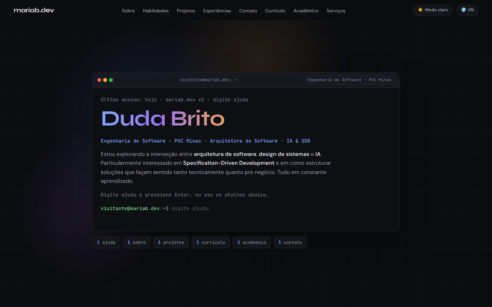 | 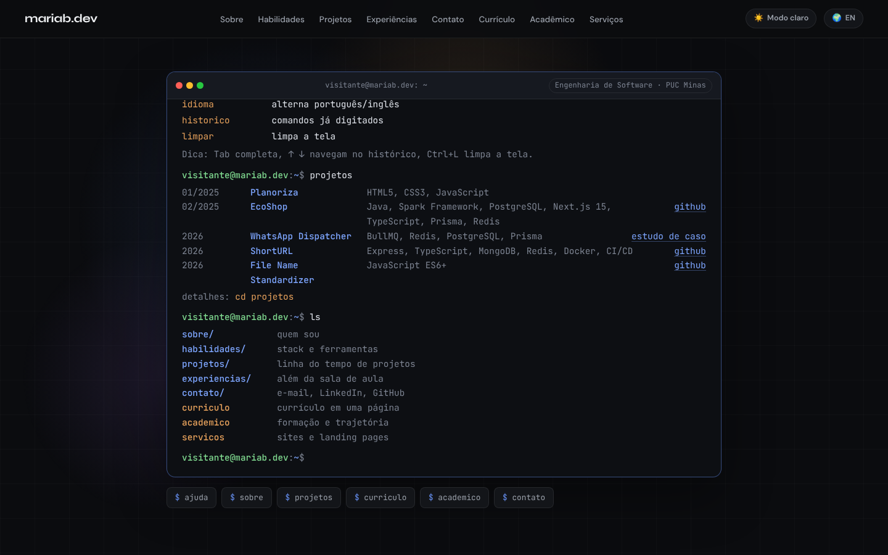 |
| **Currículo** | **Acadêmico** |
| 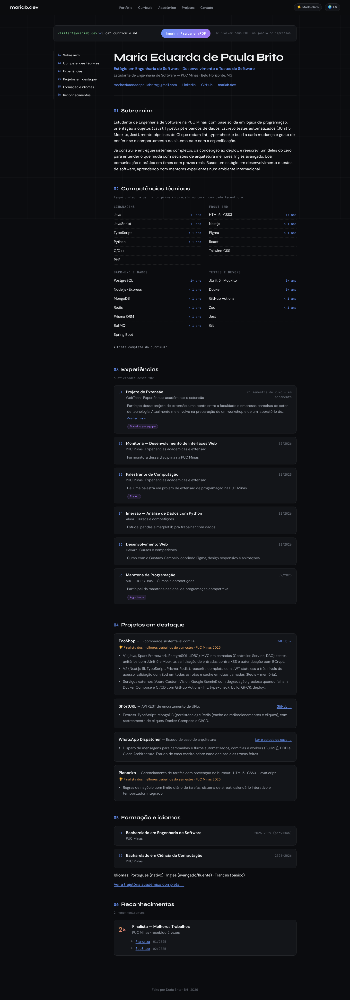 | 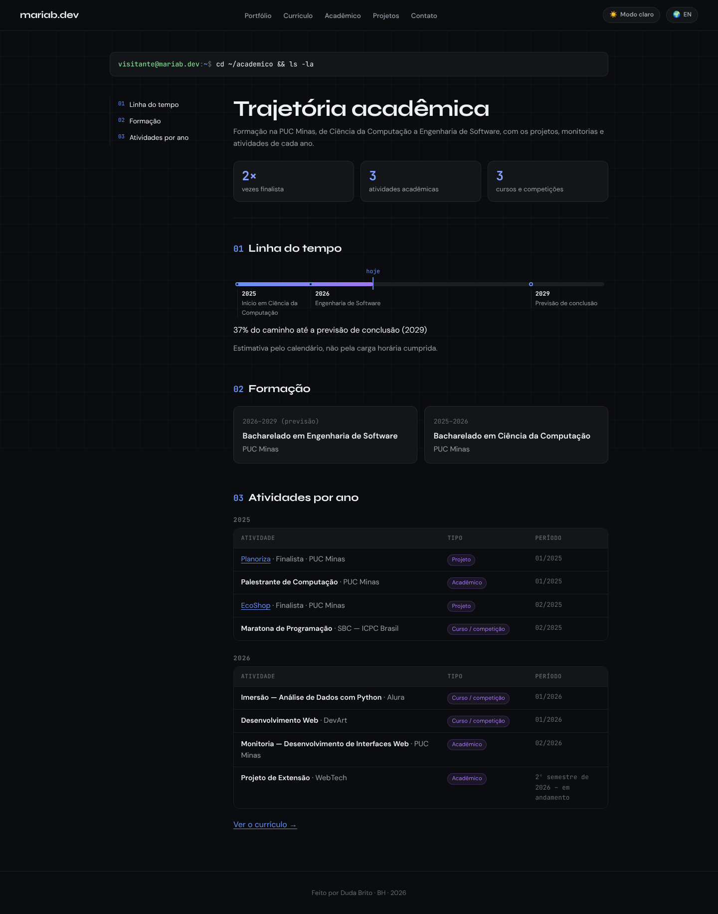 |
| **Início (versão anterior)** | **Projetos (timeline)** |
| 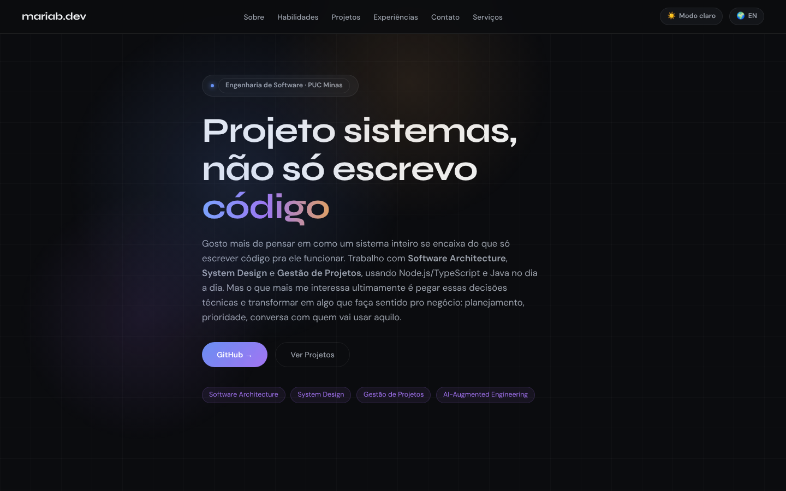 | 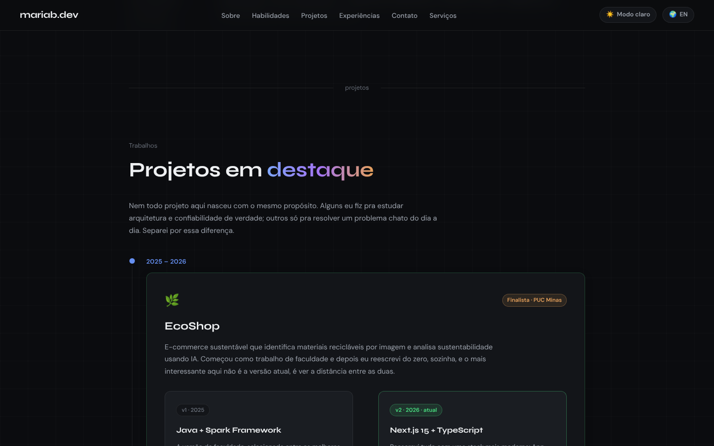 |
| **Experiências** | **Contato (tema claro)** |
| 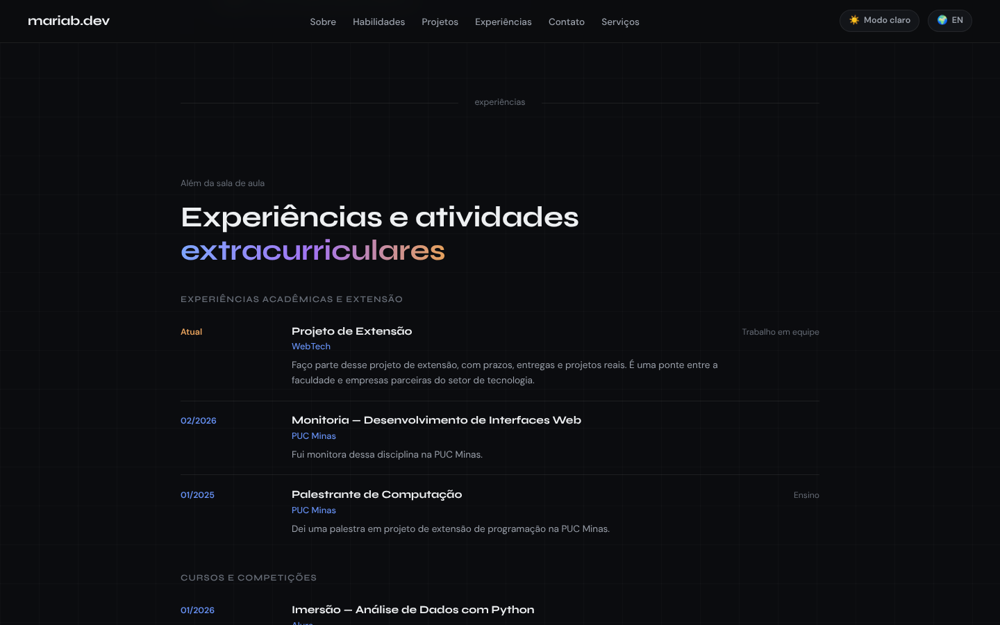 | 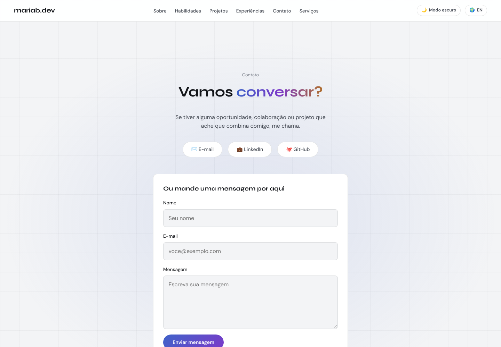 |
| **Serviços** | **Estudo de caso** |
| 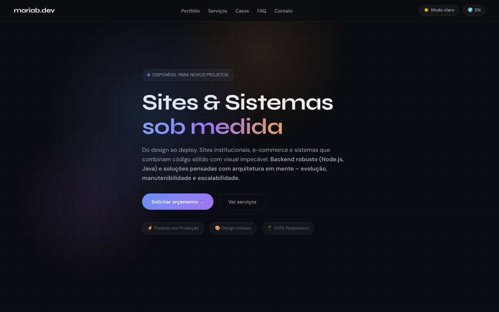 | 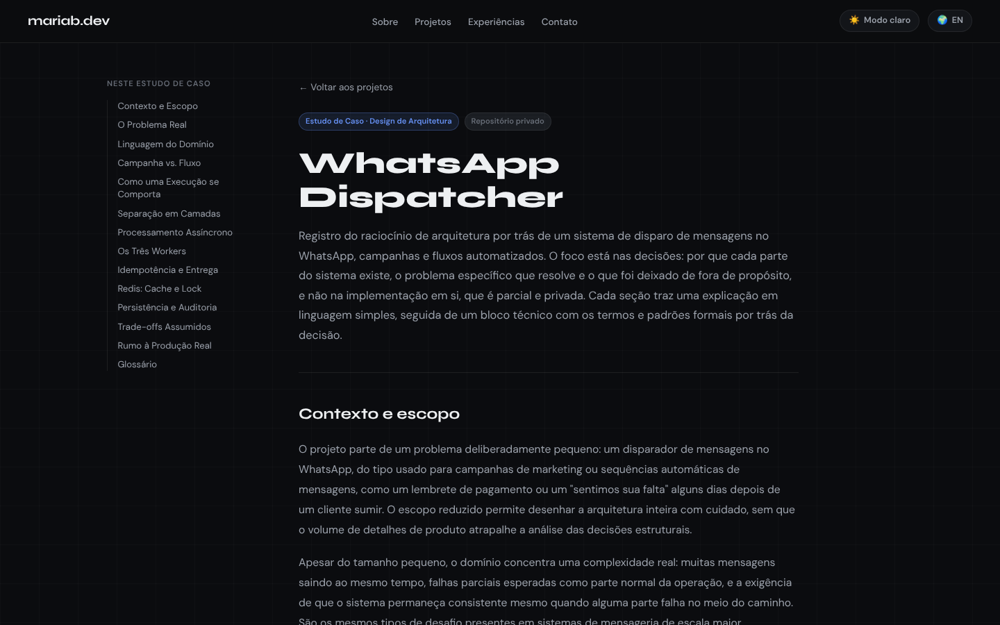 |

Mobile (390 px): 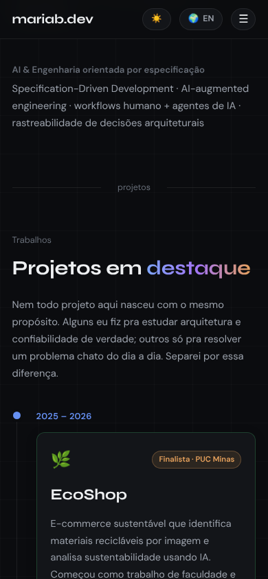 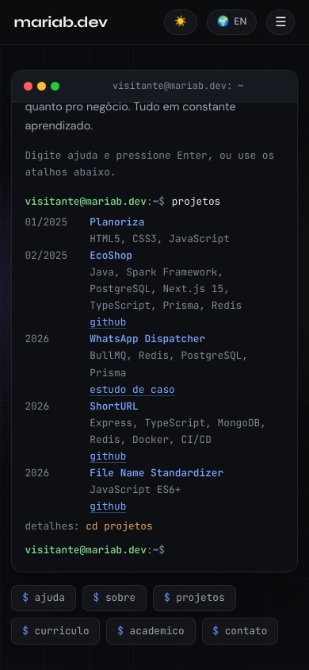

---

## 🧪 Testes

```bash
npm test        # 71 testes: terminal, currículo, acadêmico, validação, timeline, idioma, tema, navegação, FAQ, lightbox, formulário, serviço de e-mail
npm run lint
npm run build
```

**Testes unitários e de integração:** Vitest + Testing Library em jsdom (não é um navegador real). Os testes do formulário e do serviço usam o EmailJS simulado: validam comportamento e parâmetros, **não** comprovam entrega de e-mail. **E2E:** não há testes configurados (Cypress/Playwright). A verificação em navegador real (rotas, âncoras, tema, menu, lightbox, 390/768/1440 px) ainda precisa ser feita no site publicado; ver checklist em [docs/DEPLOY.md](docs/DEPLOY.md).

---

## 📌 Pendências

- **Datas dos projetos:** confirmadas Planoriza (01/2025), EcoShop v1 (02/2025) e v2 (01/2026). ShortURL, File Name Standardizer e WhatsApp Dispatcher têm só o ano (2026) e aparecem com a ordem entre eles marcada como indeterminada. Ao saber o mês, acrescente `month` em `date` no `src/data/projects.jsx`; a ordem se corrige sozinha.
- **Imagem/GIF dos projetos:** só o EcoShop tem capturas. Para ShortURL e File Name Standardizer, salve os arquivos reais em `public/cases/<id>/` (JPEG/PNG/WebP, até 300 KB) e liste os caminhos em `gallery`. Planoriza e WhatsApp Dispatcher não têm imagens; projetos sem galeria não exibem nada (sem placeholder).
- **Repositórios:** Planoriza e WhatsApp Dispatcher não têm link de repositório e nenhum foi inventado; a interface não exibe aviso nem promessa. Falta confirmar com o professor se o enunciado exige link para esses casos (Q-01).
- **Tecnologias do Planoriza/WhatsApp Dispatcher:** as do Dispatcher vieram do próprio estudo de caso (BullMQ, Redis, PostgreSQL, Prisma); confirme se quer listar outras.
- **Disciplinas e notas:** os 4 semestres existem como placeholder e nenhuma nota foi inventada. Preencha `courses` de cada semestre em `src/data/academics.js` com o histórico oficial.
- **LinkedIn:** o currículo em PDF usa `maria-eduarda-p-brito-a18064358`, enquanto o site usa `maria-eduarda-brito-a18064358` (`src/data/profile.js`). Confirme qual é o correto.
- **Tradução:** todo o conteúdo existe em PT e EN, sem lacunas conhecidas.
- **Experiências:** "WebTech" indica início no 2º semestre de 2026, em andamento, sem mês e sem cargo formal. Instituição/atividade foram separadas a partir dos títulos originais.
- **Repositório GitHub, deploy, EmailJS e Figma:** dependem de contas e ações suas; procedimentos em [docs/DEPLOY.md](docs/DEPLOY.md), na seção de EmailJS acima e em [docs/PROTOTIPOS.md](docs/PROTOTIPOS.md). Os três `ADICIONAR_*` deste README serão trocados quando existirem.
- **Prévia de link:** `og:image` ainda é relativo e faltam `og:description`/`og:url`; ajustar após definir a URL.
- Ícone da aba usa a foto do perfil; troque por um favicon dedicado se preferir (`index.html`).

---

## 🔗 Documentações utilizadas

[React](https://react.dev/) · [Vite](https://vite.dev/) · [EmailJS (SDK Browser)](https://www.emailjs.com/docs/sdk/installation/) · [Vitest](https://vitest.dev/) · [Testing Library](https://testing-library.com/docs/react-testing-library/intro/) · [WAI-ARIA Accordion](https://www.w3.org/WAI/ARIA/apg/patterns/accordion/)

---

## 👥 Autoria

| 👤 Nome | GitHub | LinkedIn | E-mail |
| --- | --- | --- | --- |
| Maria Eduarda "Duda" P. Brito | [maria-brito15](https://github.com/maria-brito15) | [LinkedIn](https://linkedin.com/in/maria-eduarda-brito-a18064358) | mariaeduardadepaulabrito@gmail.com |

## 🤝 Contribuição

Projeto pessoal, sem processo formal de contribuição. Sugestões e correções são bem-vindas: faça um fork do repositório (quando publicado), crie uma branch, rode `npm run lint` e `npm test`, abra um pull request descrevendo a mudança.

## 🙏 Agradecimentos

- [Engenharia de Software PUC Minas](https://www.instagram.com/engsoftwarepucminas/) e [Prof. Dr. João Paulo Aramuni](https://github.com/joaopauloaramuni), pelo template de documentação e orientação da atividade.

## 📄 Licença

Nenhuma licença foi definida no material recebido. _Pendente: escolher e adicionar um arquivo `LICENSE`._
